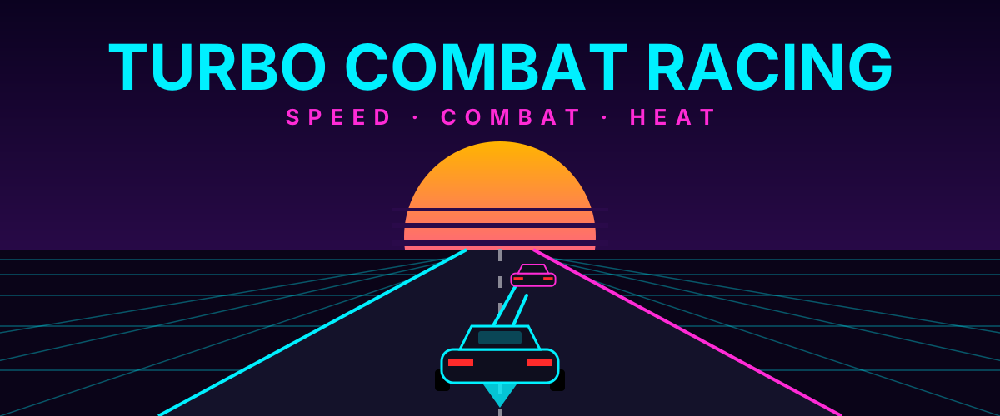

# Turbo Combat Racing

A browser-based arcade combat racing game built with plain HTML5 Canvas and JavaScript. No build step, no dependencies.



Three systems feed each other: **speed** (boost to pull ahead), **combat** (shoot rivals, dodge their fire) and **resource management** (boosting builds heat, overheating slows and damages you).

## Play

Open `index.html` in a browser. Or serve the folder locally:

```bash
python -m http.server 8000
# then open http://localhost:8000
```

## Controls

| Key | Action |
| --- | --- |
| W / Up | Accelerate |
| S / Down | Brake / reverse |
| A, D / Left, Right | Steer |
| Shift | Boost (builds heat) |
| Space | Shoot |

Pickups on the track: **A** ammo, **+** repair, **C** coolant (they respawn after 8 seconds).

## Cars

| Car | HP | Top speed | Notes |
| --- | --- | --- | --- |
| F40 | 471 | 324 km/h | Balanced |
| Aventador | 700 | 350 km/h | Fastest, runs hottest, lowest armor |
| 911 GT3 | 502 | 318 km/h | Best handling and cooling, most armor |

HP and top speed are approximate real-world figures shown on the selection screen. In-game values live in `js/cars.js`.

## Heat model

```
Heat_final = Heat_initial + (Boost_time x Rate) - (Cooling_constant)
```

Applied every frame in `js/heat.js`. At 100 heat the engine overheats: boost locks, top speed drops 40% and you take damage until heat falls to 40.

## Project structure

```
turbo-combat-racing/
  index.html          pages: home, car select, game, result, about, contact
  css/style.css       neon-glow theme and HUD
  js/cars.js          config values and the three cars
  js/collision.js     geometry helpers, track, circle and AABB collision
  js/heat.js          heat formula
  js/ai.js            rival driving and predictive auto-combat
  js/game.js          60 FPS fixed-step loop, update(), render()
  js/ui.js            navigation, car selection, result screen
  assets/             cover.svg, cover.png
  docs/               design document (PDF), roadmap, deployment notes
```

## Deploy

See [docs/deployment.md](docs/deployment.md) for GitHub Pages, Netlify and itch.io.

## Roadmap

See [docs/roadmap.md](docs/roadmap.md): audio, procedural tracks, then multiplayer and ML-trained AI.
